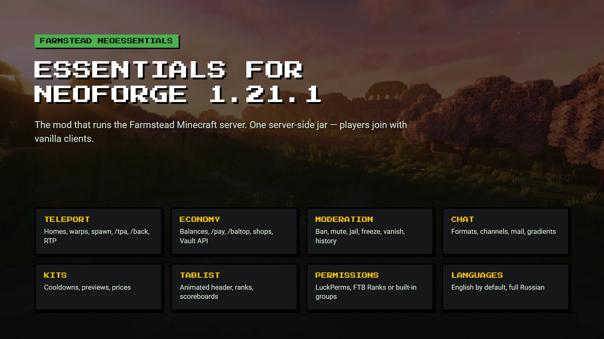
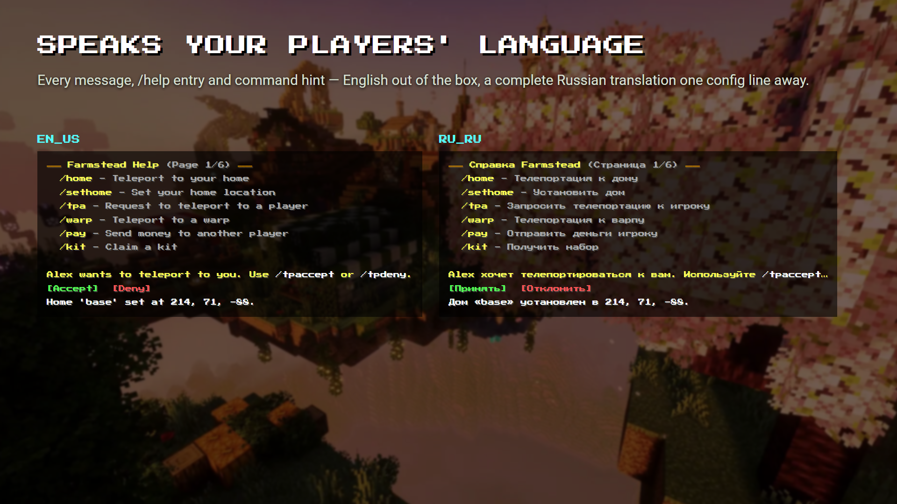
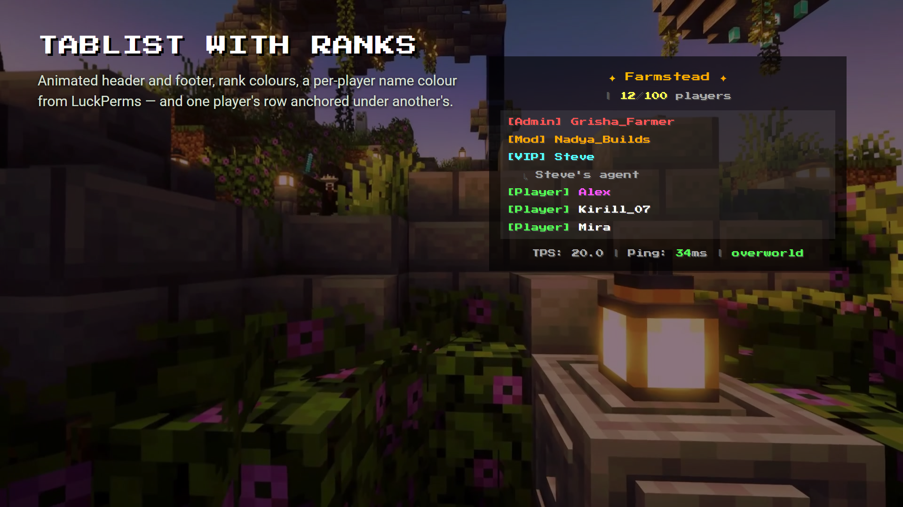
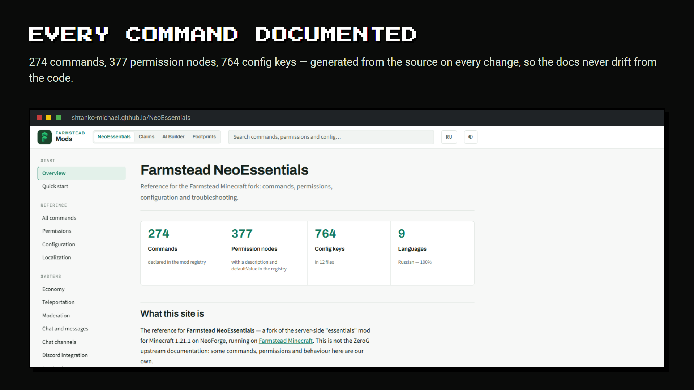
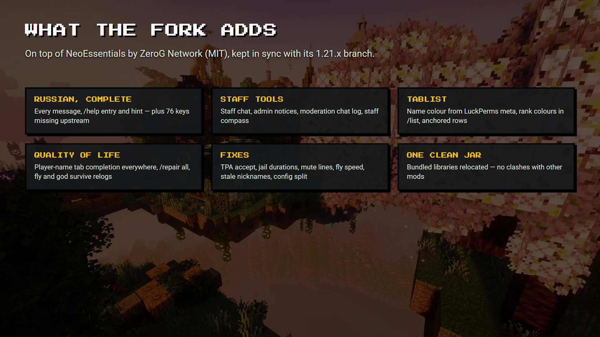

# The essentials mod that runs the Farmstead server

**Farmstead NeoEssentials** is the essentials mod behind the [Farmstead Minecraft](https://farmsteadminecraft.online) server: homes, warps, TPA, economy, kits, moderation, chat and tablist in one server-side jar. Players join with a vanilla client; nothing to install on their side.

> **A fork, not the original.** Farmstead NeoEssentials is a fork of [NeoEssentials by ZeroG Network](https://github.com/ZeroG-Network-PTY-LTD/NeoEssentials) (MIT), kept in sync with its `1.21.x` branch. It is not made, endorsed or supported by the original authors: report problems with this build on [our issue tracker](https://github.com/shtanko-michael/NeoEssentials/issues). It keeps the mod id `neoessentials`, so it **replaces** the original: remove the original jar before installing this one.

---

## ✦ See it

| | |
| --- | --- |
|  **Speaks your players' language** |  **Tablist with ranks** |
|  **Every command documented** |  **What the fork adds** |

## ✦ Documentation

Every command, permission node and config key, generated from the source on every change, with worked examples and known issues: **[shtanko-michael.github.io/NeoEssentials](https://shtanko-michael.github.io/NeoEssentials/)**. Press `/` on any page to search.

## ✦ What's inside

- **Teleportation**: homes, warps, spawn, `/tpa`, `/back`, random teleport, safe landing.
- **Economy**: balances, `/pay`, `/baltop`, chest and NPC shops, `/sell` and `/worth`, a Vault-compatible API for other mods.
- **Moderation**: ban, temp-ban, IP ban, mute, jail, freeze, vanish, sudo, punishment history.
- **Chat**: formats per group and per world, channels, private messages, mail, mentions, gradients and rainbow text.
- **Kits**: cooldowns, previews, economy costs.
- **Tablist and scoreboard**: animated header and footer, per-group layouts, sidebar boards, leaderboards.
- **Permissions**: LuckPerms, FTB Ranks or the built-in groups.
- **Web dashboard and REST API**: live server view and config editing in the browser.
- **9 languages**: English by default, a complete Russian translation, one config line to switch.

## ✦ What this fork adds on top of NeoEssentials

- **Complete Russian localization**: every message, `/help` entry and command hint.
- **Staff tools**: staff chat, admin notices, a moderation chat log, a staff compass teleport.
- **Tablist**: a per-player name colour from a LuckPerms meta key, rank colours in `/list`, one player's row anchored under another's.
- **Quality of life**: player-name tab completion in every command that takes a player, `/repair all`, fly and god mode survive a relog, mobs ignore god-mode players, configurable join and quit announcements.
- **Works with [Farmstead Claims](https://shtanko-michael.github.io/NeoEssentials/en/claims/)**: `/home`, `/tpa` and `/back` will not land a player in a region that forbids teleporting in.
- **Fixes**: immediate TPA acceptance, jail durations, mute message line breaks, fly speed, stale nicknames after a rename, config-split data loss, vanilla `/help` hijacking `/help <page>`, command-name case handling, permission details leaking in denial messages.
- **One shaded jar**: bundled libraries are relocated, so they cannot clash with another mod's copy of HikariCP, SnakeYAML or Java-WebSocket.

## ✦ Install

1. NeoForge **21.1.179 or newer** for Minecraft **1.21.1**, Java 21.
2. Drop the jar into the server's `mods/` folder (and remove the original NeoEssentials jar, if any).
3. Start the server once: configs appear in `config/neoessentials/`.
4. Grant permissions: by default almost everything needs an explicit grant (`permissions.requireExplicitGrant`). The [quick start](https://shtanko-michael.github.io/NeoEssentials/en/quickstart/) lists the nodes a regular player needs.
5. `/neoessentials reload` applies config changes without a restart.

## ✦ Versions

| Minecraft | Loader | Side |
| --- | --- | --- |
| 1.21.1 | NeoForge 21.1.179+ | Server only |

---

NeoEssentials was created by **MrWhiteFlamesYT** and **ZeroG Network**: support the original work on [Ko-fi](https://ko-fi.com/mrwhiteflamesyt). The Farmstead fork is made by **[Farmstead](https://farmsteadminecraft.online)** · [Source](https://github.com/shtanko-michael/NeoEssentials) · [Issues](https://github.com/shtanko-michael/NeoEssentials/issues) · [Documentation](https://shtanko-michael.github.io/NeoEssentials/) · MIT
